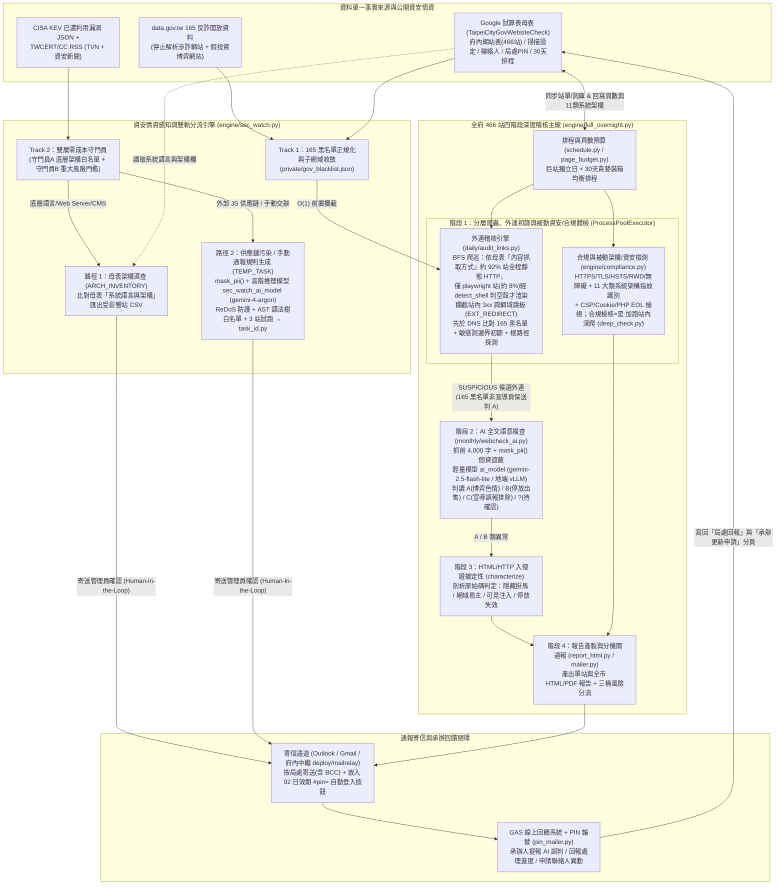

# web_check — 政府網站檢核整合工具

臺北市政府 466 個網站的自動化檢核。三個子系統整合在同一專案、共用一份設定與服務帳戶：

| 子系統 | 資料夾 | 頻率 | 做什麼 | 產出 |
|---|---|---|---|---|
| **monthly** 每月檢核輔助 | `monthly/` | 每月（本機） | ~~monthly_check 已退役~~；合規檢核搬入 `engine/compliance.py`，保留 `deep_check` / `update_excel` / `webcheck_ai` | 檢核表 Excel（讀 `compliance.json`） |
| ~~daily~~ | `daily/` | **已退役** | 外連稽核引擎 `audit_links.py` 保留；寄信併入 `engine/mailer.py` | — |
| **engine** 統一引擎 | `engine/` | 手動 / 整夜 / 排程 | 靜態優先抓取地基 + 全 466 站四階段深度稽核 + 合規與被動資安標頭/架構檢測 + **政府 165 黑名單與資安情資感知 (`sec_watch`)** + **按局處寄信（AI 複查後）** + HTML 報告 | `private/reports/` + Email |

全系統共用：一份 `config.json`、一個 GA 服務帳戶金鑰、同一張 Google 試算表。唯一手動維護的母表是 **「府內網站表」**（466 站，`config.SITE_LIST_WS`）；合規檢核由 `engine/compliance.py` 產出 `compliance.json`（含 11 大類系統語言架構與被動資安標頭檢視），深掃結束自動將「頁數」與「系統語言與架構」寫回母表。詞庫/分頁參數/白名單/補充黑名單在「掃描設定」分頁、寄信收件與密件副本在「局處聯絡人員表」、回饋頁登入碼在「局處PIN」分頁。

> 完整架構、資料流、設計決策與技術債見 **[docs/ARCHITECTURE.md](docs/ARCHITECTURE.md)**；資安情資感知雙軌設計見 **[docs/SEC_INTEL_DESIGN.md](docs/SEC_INTEL_DESIGN.md)**。

## 系統架構圖



## 一鍵 / 常用執行

- **排程深掃+寄信**（每晚只掃今天那批）：`python -m engine.full_overnight --schedule-today --mail --workers 6`
- **全站深度稽核+寄信**（找搶註/掛馬 + 合規與架構檢測，全量）：`python -m engine.full_overnight --workers 6 --mail`
  - 只掃某局處：`--org 教育局`；定點重測：`--only <關鍵字>`；淺掃驗證：`--force-cap 20`；中斷續跑：`--resume <報告目錄>`
  - 不重爬、對既有報告重跑階段 2~4 AI 複查：`python -m engine.full_overnight --verify <報告目錄>`
  - 對既有報告補寄：`python -m engine.mailer <報告目錄> [--dry-run] [--mail-to <測試信箱>]`
- **資安情資感知與雙軌分流清查（`sec_watch`）**：
  - 同步 165 反詐黑名單 + 巡檢 CISA KEV 與 TWCERT 新公告（雙層守門員過濾個別廠商系統，底層語言/共用平台漏洞直接查母表架構匯出 CSV）：`python -m engine.sec_watch --mail`（預覽加 `--dry-run`）
  - 一次快速回填全府 466 站「系統語言與架構」欄：`python -m engine.sec_watch --fill-arch`
  - 手動餵入交辦公文或網址產出清查任務：`python -m engine.sec_watch --from-url <網址> --mail` 或 `--from-text "<內容>" --mail`
  - 一鍵對全府 466 站執行臨時清查任務：`python -m engine.sec_watch --run-task <任務ID> --mail`（查看任務：`--list-tasks`）
- **HTML 報告產生**（單站+全市，吃 AI 複查降級與合規紅綠燈）：`python -m engine.report_html --zip`
- **站況體檢**（更新時效/停更）：`python -m engine.scan --profile health --sheet`
- **排程與維運工具**：
  - 月度排程：`python -m engine.schedule --rebuild`（重算 30 天分批）、`--today`（印今天那批）
  - 月度白名單健檢：`python -m engine.whitelist_recheck [--mail]`（Playwright 重驗 `skip_hosts` 是否失效或變質）
  - 回饋頁 PIN 碼每季輪替：`python -m engine.pin_mailer --rotate --no-mail`

## 安裝

```bash
pip install -r requirements.txt
```

## 設定（集中在 private/，整個 gitignore）

1. 複製 `config.example.json` → `private/config.json`，填入：
   - AI 供應商（`ai_provider`：`openai` / `anthropic` / `gemini`）
   - `master_sheet_id`：Google 試算表 ID
   - `mail` / `gmail` / `relay`：寄信方式（`outlook`、`gmail` SMTP 或府內中繼 `relay`）
   - `mail_override_to` / `mail_copy_to` / `sec_watch_mail_to` / `feedback_url`：管理員兜底與通知信箱、GAS 回饋頁網址
2. GA 服務帳戶金鑰命名 `ga-service-account.json` 放進 **`private/`**
3. 首次建節點對照表：`cd monthly && python node_check.py map`

> 服務帳戶需有試算表編輯權；詞庫、白名單（`content_whitelist`）、免檢名單（`skip_hosts`）與手動補充黑名單（`gov_blacklist_extra`）統一在試算表「掃描設定」分頁維護。

### AI 供應商（高低階模型分流，送審前自動經 `mask_pii` 遮蔽個資）

- **日常外連語意判讀（`ai_model`）**：高頻、大量外部網頁之 A/B/C 語意分類，建議設定輕量快速模型（如 `gemini-2.5-flash-lite`）以控制成本。
- **資安情資規則與清查腳本生成（`sec_watch_ai_model`，選填）**：低頻、需高精準度推理與撰寫正規表示式之 `sec_watch` 任務，可獨立指定高階推理模型（如 `gemini-4-argon`；留空時，`ai_provider=gemini` 預設用 `gemini-4-argon`，其他供應商沿用 `ai_model`）。

| `ai_provider` | 走法 | `ai_model`（外連初篩）範例 | `sec_watch_ai_model`（規則生成）範例 | 需裝套件 |
|---|---|---|---|---|
| `openai` | OpenAI 相容 HTTP（地端 vLLM/Ollama，或 OpenAI/OpenRouter/Groq）| `gpt-4o-mini` / 地端模型 | `gpt-4o` / 地端高階模型 | 無 |
| `anthropic` | 官方 Claude SDK | `claude-haiku-4-5` | `claude-opus-4-8` | `anthropic` |
| `gemini` | Gemini OpenAI 相容端點 | `gemini-2.5-flash-lite` | `gemini-4-argon` | 無 |

### 寄信（`engine/mailer.py`，深掃後按局處彙整寄送）

- `method: outlook`：本機 Windows + Outlook
- `method: gmail`：Linux 主機 SMTP，需在 `gmail.app_password` 填 Google 應用程式密碼
- `method: relay`：經府內寄信中繼服務（`deploy/mailrelay/relay.py`，支援多系統 token 與 CC/BCC）轉送府內 Mail Relay
- 深掃加 `--mail` 自動寄，收件人讀府內網站表「局處Email」欄（支援多收件人逗號/分號分隔），並依「局處聯絡人員表」自動帶入密件副本（BCC）與「局處PIN」專屬 `#pin=` 回饋頁自動登入按鈕。

## 資料夾結構

```
websitecheck/
├─ config.py / config.example.json      共用設定
├─ scan_settings.py                     掃描設定單一來源(Sheet「掃描設定」→快取→內建預設)
├─ 每日稽核.bat                          Windows 一鍵深掃+寄信入口
├─ monthly/   每月檢核輔助（deep_check、update_excel、webcheck_ai、smoke_test…）
├─ daily/     連結稽核引擎（audit_links.py 保留；寄信已移至 engine/mailer.py）
├─ engine/    統一引擎（full_overnight、compliance、sec_watch、mailer、report_html、schedule…）
├─ deploy/    主機部署與府內寄信中繼服務（hermes_update.sh、mailrelay/）
├─ docs/      架構、資安情資感知與雲端化文件（見下）
└─ private/   機敏、個資、快取與產出（gitignore）
   ├─ config.json / ga-service-account.json
   ├─ gov_blacklist.json / sec_watch_seen.json / sec_tasks/
   ├─ sites.json / nodes_map.json / TCGweb_466站對照清單_v2.csv
   └─ reports/ / reports_html/ / 檢核表/
```

## 文件（`docs/`）

| 文件 | 內容 |
|---|---|
| [ARCHITECTURE.md](docs/ARCHITECTURE.md) | 系統全貌、資料流、關鍵設計決策、技術債 |
| [SEC_INTEL_DESIGN.md](docs/SEC_INTEL_DESIGN.md) | 政府資安情資感知（165 黑名單自動攔截 + CISA KEV/TWCERT 雙層守門員、母表架構直查與宣告式清查任務）設計與實作規格 |
| [SECURITY_CLOUD.md](docs/SECURITY_CLOUD.md) | 資安清單／上雲機敏處理指引（哪些不可公開、怎麼注入） |

## 授權

MIT（見 LICENSE）。內含之機關特定設定、個資、金鑰均在 `private/`，不在此 repo。
