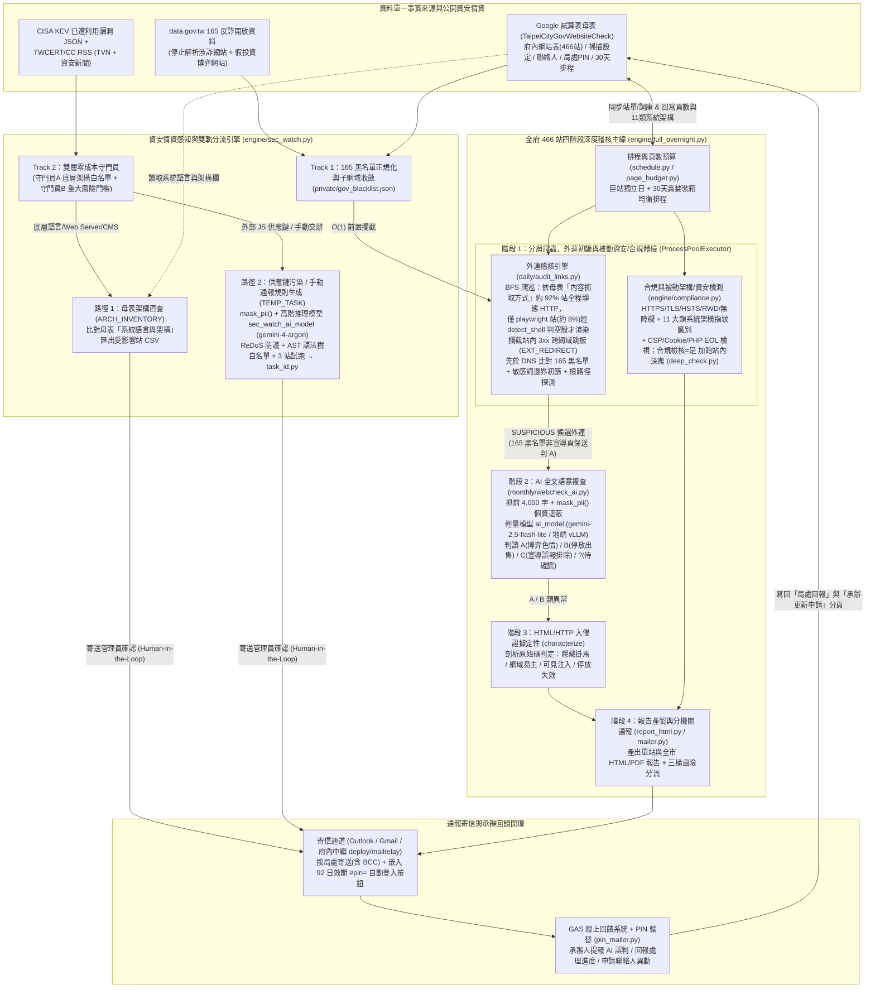
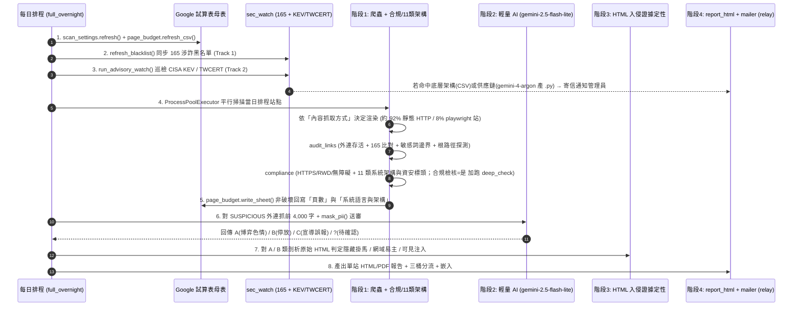

# websitecheck 專案架構文件

> 本文件由程式碼全面走讀後整理，供日後回來快速上手。**只描述現況**。
> 最近更新（2026-11）：
> - **Phase 3（資安情資感知與被動架構/標頭資安檢測）**：新增 `engine/sec_watch.py`（Track 1：自動同步 `data.gov.tw` 165 反詐涉詐/博弈黑名單，先於 DNS O(1) 攔截並辨識反詐宣導頁、階段 2 保送判 A；Track 2：巡檢 CISA KEV 結構化 JSON 與 TWCERT RSS，經「底層語言/共用平台標題白名單 + 重大風險門檻」雙層零成本守門員過濾個別民間公司私用系統，並分為 `ARCH_INVENTORY` 母表「系統語言與架構」直查免跑腳本與 `TEMP_TASK` 宣告式清查任務，支援 `--fill-arch` 快速回填全府 466 站架構欄位）、`compliance.check_tech_and_security`（零額外請求識別 11 大類系統語言架構與 PHP EOL / CSP / Session Cookie / CKEditor 等被動資安檢測，並自動寫回 Sheet「系統語言與架構」欄）、`webcheck_ai.mask_pii` 送 AI 前個資遮蔽。
> - **寄信中繼與回饋閉環（2026-08~10）**：新增府內寄信中繼 `deploy/mailrelay/relay.py`（`method=relay`，支援多 token 與 CC/BCC）、稽核信三桶風險分流＋`#pin=` 自動登入回饋頁（`engine/pin_mailer.py` 每季輪替）、多收件人與密件副本（BCC）、單站報告轉 PDF 附件、`engine/whitelist_recheck.py` 月度白名單健檢，以及 `audit_links.py` 攔截站內 3xx 跨網域跳板（`EXT_REDIRECT`）、趨勢科技 ClickTime 包裝網址、Cloudflare 403 `curl` 複查與 `service.taipei` SPA 404 瀏覽器複查。
> - **Phase 1~2 基礎（2026-07）**：試算表以「府內網站表」為單一母表、詞庫/分頁/白名單單一來源化（`scan_settings.py`）、`monthly_check.py` 退役併入 `engine/compliance.py`、`report_html.py` 報告產生器、`schedule.py` 月度排程、GitHub Actions CI。

---

## 1. 這個專案在解決什麼問題（白話版）

臺北市政府（資訊局）要定期確認轄下 466 個網站「還健康、沒出事」。實務上有三大核心任務：

1. **每月合規與被動資安體檢**——每個機關網站要符合規定：HTTPS 憑證效期、HTTP→HTTPS 轉址、HSTS、手機版（RWD）、站內搜尋、無障礙標章、首頁與站內失效連結、下載檔提供 ODF/PDF 通用格式、最新消息更新時效，以及**被動識別網站底層語言框架（PHP / ASP.NET / Java / Node.js 等 11 類）與 HTTP 資安標頭／過期元件風險**。
2. **外部連結網域被搶註 / 掛馬 / 涉詐攔截**（最核心也最花心力的部分）——
   政府網站常在新聞稿、活動頁連到「當年委外廠商的活動官網」。活動結束、網域過期釋出後，**博弈/色情/詐騙集團會把過期網域註冊走**，導致政府網站無意間幫賭場或詐騙站導流。數發部 115/6/8 發文要求各機關清查「委外案或活動結束後未移除的網址」，本專案將清查自動化：
   **爬完整站 → 收集所有對外連結（含站內 3xx 轉址跳板） → 比對 165 反詐黑名單 + 檢測存活與賭博/色情/停放關鍵字 → 地端/雲端 AI 二次複查 → 按局處自動寄發通知信與回饋頁連結**。
3. **突發資安情資感知與雙軌分流清查（`sec_watch`）**——
   當 CISA KEV（已知遭積極利用漏洞清單）或 TWCERT/CC 發布重大漏洞警訊時，先經「底層語言/共用平台標題白名單 + 重大風險門檻」雙層零成本守門員過濾個別民間公司私用系統：凡屬 PHP、ASP.NET、IIS、Java/HyWeb、Apache、Nginx、Node.js、WordPress、CCMS 等底層架構漏洞，**免產出 `.py` 腳本、零 AI 呼叫**，直接查詢母表「系統語言與架構」欄匯出受影響候選網站 CSV 寄給管理員；若屬第三方腳本供應鏈污染（如 `polyfill.io`）或上級交辦臨時清查公文，則產出經安全沙盒驗證的宣告式清查規則，一鍵即可在 1~2 分鐘內掃完全府 466 站首頁。

**核心難點在於「不能亂喊狼來了」**：反毒/反詐宣導頁會提到「賭博/詐騙」、藝文報導會出現敏感字眼、法文網頁的 `spécialiste` 會誤撞 `cialis`、ASP.NET 網站頁尾連到友站 `.php` 不代表它是 PHP 網站——因此本專案透過**多層防誤報機制**（詳見 §5）確保報告公信力。

---

## 2. 子系統分工與單一事實來源



| 子系統 | 資料夾 | 頻率 | 做什麼 | 產出 |
|---|---|---|---|---|
| **合規檢核輔助** | `monthly/` | 每月 / 隨深掃 | `monthly_check.py` 已退役；檢查邏輯搬進 `engine/compliance.py`。保留 `deep_check.py`（被 compliance 匯入）、`update_excel.py`（讀 `compliance.json` 產 Excel）、`webcheck_ai.py`（共用 AI 與 `mask_pii`） | 檢核表 Excel |
| **外連稽核核心** | `daily/` | 隨深掃呼叫 | 連結稽核引擎 `audit_links.py`（純引擎模組，寄信已併入 `engine/mailer.py`） | — |
| **統一引擎** | `engine/` | 手動 / 整夜 / 排程 | 靜態優先分層抓取 + 全 466 站四階段深度稽核 + 合規與架構資安檢測 + 165 黑名單與資安警訊感知 (`sec_watch`) + 按局處寄信 (`mailer`) + HTML 報告 (`report_html`) | `private/reports/` + Email |
| **部署與寄信中繼** | `deploy/` | 常駐 / CI 後更新 | `mailrelay/relay.py` 府內 HTTPS→SMTP 寄信中繼服務、`hermes_update.sh` 主機拉取更新腳本 | — |

### 資料的單一事實來源：Google 試算表
全系統共用同一份 `config.py`、同一個 Google 服務帳戶與同一張 Google 試算表（共 5 張主要分頁）：

| 分頁 | 角色 |
|---|---|
| **府內網站表** | 唯一手動維護的 466 站母表（`config.SITE_LIST_WS`）：網站名稱、網址、局處、`內容抓取方式`、`合規檢核`（`是`=納入月度深度合規與 AI 題目）、`AI判讀題目`、`頁數`＆`頁數更新日`（深掃自動回填）、`系統語言與架構`（深掃自動回填）、`局處Email`（XLOOKUP 公式欄） |
| **掃描設定** | 詞庫（`suspicious_keywords`、`parked_keywords`、`characterize_extra_keywords`、`benign_phrases`）、分頁參數（`pagination_params`）、白名單（`content_whitelist`）、免檢名單（`skip_hosts`）與手動補充黑名單（`gov_blacklist_extra`），由 `scan_settings.py` 啟動時拉取快取 |
| **局處聯絡人員表** | 局處 → 承辦人/分機/Email（支援多格承辦串接）與 `密件副本人員`（BCC），供 `mailer.py` 與母表 XLOOKUP 使用 |
| **局處PIN** | 局處 → 回饋頁專屬 8 碼 PIN 與效期（由 `engine/pin_mailer.py` 產生與每季輪替，`mailer.py` 自動讀取並嵌入信件按鈕 `#pin=`） |
| **月度掃描排程** | 466 站分 30 天輪替計畫（由 `engine/schedule.py --rebuild` 自動計算寫回） |

- 大量掃描讀取本機快照 `private/TCGweb_466站對照清單_v2.csv`——**`full_overnight` 與 `mailer` 執行前皆會自動從「府內網站表」重新下載**（`page_budget.refresh_csv`，原子寫入，失敗沿用舊快照），因此改站清單、抓取方式或聯絡人**只需改 Sheet**。

---

## 3. 資料夾與檔案結構（逐檔職責）

```
websitecheck/
├─ config.py                 共用設定載入器(支援環境變數覆寫; private/config.json → 根目錄 → example)
├─ scan_settings.py          掃描設定單一來源(Sheet「掃描設定」→ 快取 → 內建預設 DEFAULTS)
├─ config.example.json       設定範本(公開)
├─ 每日稽核.bat               Windows 一鍵深掃+寄信入口
├─ requirements.txt
│
├─ monthly/   ── 合規檢核輔助與共用 AI 模組 ──
│   ├─ deep_check.py         站內深度 BFS(≤150頁)：內部失效連結 + Office 檔缺 PDF/ODF 替代版
│   ├─ node_check.py         檢核表(一) 逐節點 AI 內容判讀
│   ├─ ga_traffic.py         撈 GA4 screenPageViews(檢核表的「網站流量數」)
│   ├─ probe_method.py       探測每站抓取方式 → 寫回府內網站表「內容抓取方式」欄
│   ├─ sync_config.py        府內網站表(合規檢核=是) → private/sites.json
│   ├─ update_excel.py       讀 compliance.json 產檢核表 Excel(以「網站名稱」對齊工作表)
│   ├─ webcheck_ai.py        ★ 共用 AI 模組：fetch_html / html_to_text / mask_pii / ask_ai
│   │                        (支援 openai 相容 / anthropic / gemini，送審前自動遮蔽 Email/身分證/手機)
│   ├─ smoke_test.py         部署冒煙測試(驗證套件、全模組匯入與設定檔)
│   └─ 每月建立檢核表.gs      Google Apps Script(試算表端)
│
├─ daily/     ── 外連稽核引擎核心 ──
│   └─ audit_links.py        ★★ 爬取單站內部頁 → 收集外連(含站內 3xx 跨網域轉址) → 逐連結判風險
│
├─ engine/    ── 統一引擎(共 14 個模組，詳見 §3.1) ──
│
├─ deploy/    ── 部署與府內寄信中繼 ──
│   ├─ hermes_update.sh      掃描主機拉取更新與環境驗證腳本
│   └─ mailrelay/            府內寄信中繼服務(relay.py + systemd service + env 範本)
│
├─ docs/      ── 專案文件 ──
│   ├─ ARCHITECTURE.md       本文件：系統全貌、資料流與設計決策
│   ├─ SEC_INTEL_DESIGN.md   資安情資感知模組(sec_watch)雙軌設計與安全沙盒規格
│   └─ SECURITY_CLOUD.md     上雲機敏處理指引
│
└─ private/   ── 機敏/個資/快取/產出，整個 gitignore ──
    ├─ config.json / ga-service-account.json
    ├─ scan_settings_cache.json / gov_blacklist.json / sec_watch_seen.json
    ├─ sec_tasks/            sec_watch 生成之宣告式臨時清查任務(task_<id>.py)
    ├─ TCGweb_466站對照清單_v2.csv
    └─ reports/ & reports_html/
```

### 3.1 `engine/` 模組一覽（14 個檔案）

分成三層：**地基（抓取/情資）→ 中層（爬取/預算）→ 上層（驅動/合規/寄信/報告/排程）**。

| 檔案 | 層 | 職責 |
|---|---|---|
| `__init__.py` | — | 整併說明 docstring |
| **`fetch_layered.py`** | 地基 | ★ **靜態優先分層抓取與空殼偵測**。先靜態抓 → `detect_shell` 判是否為 JS 空殼/frameset/內容過少 → 僅在必要且 `allow_render=True` 時呼叫 `render_to_html` 升級 Playwright 渲染（`crawl.py`/`scan.py` 直接呼叫 `fetch_layered()`；`audit_links.py` 則依母表「內容抓取方式」在 `ALLOW_RENDER=True` 即 `playwright` 站時匯入 `detect_shell` 與 `render_to_html` 按需渲染）。內建 `NEVER_RENDER` (`wifi.taipei`) 與 `FORCE_MANUAL` (`travel.taipei`) 保護名單 |
| `dates.py` | 地基 | 從 HTML 抽取「最新更新日期」並正規化 |
| **`sec_watch.py`** | 地基/上層 | ★★ **政府資安情資感知模組**。Track 1：同步 165 反詐開放資料集與補充黑名單至 `private/gov_blacklist.json`（單字元來源碼低記憶體設計），供 `audit_links` O(1) 比對；Track 2：巡檢 CISA KEV JSON 與 TWCERT RSS，經雙層零成本守門員過濾後分流為 `ARCH_INVENTORY`（母表「系統語言與架構」直查匯出 CSV，免產出 `.py`）與 `TEMP_TASK`（宣告式規則 `TASK_RULES`，含 ReDoS 防護與 AST 白名單），並支援 `--fill-arch` 全府架構快速回填與 `--run-task` 快掃 |
| **`crawl.py`** | 中層 | 健康向深層 BFS 爬蟲（`crawl_site`），供 `scan.py` 使用 |
| `page_budget.py` | 中層 | 每站頁數自適應與母表回寫：管理 `TCGweb_466站對照清單_v2.csv` 快照更新、`get_cap`（上次頁數+100），並在深掃後將「頁數」、「頁數更新日」與「系統語言與架構」寫回府內網站表 |
| **`full_overnight.py`** | 上層 | ★★ **全 466 站四階段深度稽核主驅動**。整合 `audit_links`、`compliance`、`sec_watch`、`page_budget`、`report_html` 與 `mailer`。支援 `--schedule-today`、`--verify`、`--resume`、`--force-cap` |
| **`compliance.py`** | 上層 | ★ **合規與被動式架構/資安檢測模組**。基本合規（HTTPS 憑證/轉址/HSTS、RWD、站內檢索、無障礙標章、首頁失效連結）＋ **`check_tech_and_security`（11 大類系統架構指紋識別與 PHP EOL / CSP / Session Cookie / CKEditor 等被動資安標頭檢查）** 466 站全做；`deep_check` 與 AI 題目判讀僅對「合規檢核=是」的站執行 |
| **`mailer.py`** | 上層 | 深掃寄信模組：按局處彙整異常、過濾 AI 判 C 誤報、分成三桶（建議優先處理 / 建議更新連結 / 請協助人工確認），嵌入局處專屬 `#pin=` 回饋頁自動登入按鈕，附 CSV 與單站正式報告 PDF，支援 `outlook` / `gmail` / `relay` 與 BCC |
| **`pin_mailer.py`** | 上層 | 產生或每季輪替各局處回饋頁 8 碼 PIN（寫入 Sheet「局處PIN」分頁，`--rotate --no-mail`） |
| **`report_html.py`** | 上層 | HTML 報告產生器：產出按局處歸檔的單站報告（含異常連結、合規與系統架構/資安標頭紅綠燈、AI 排除誤報附錄）與全市總報告 |
| **`schedule.py`** | 上層 | 月度掃描排程：`--rebuild`（巨站獨立日 + 貪婪裝箱均衡分 30 天寫回 Sheet）、`--today`（取出今日批次） |
| **`whitelist_recheck.py`** | 上層 | 月度白名單健檢：每月用 Playwright 真瀏覽器重載 `skip_hosts` 免檢站，確認未失效且未出現賭博/色情關鍵字，異常時產 CSV 並寄信示警 |
| **`scan.py`** | 上層 | 健康（停更）剖面驅動：`health_profile` 檢查各站最新消息更新時效與停更狀態 |

---

## 4. 端到端流程：資料怎麼流動

### 4.1 全站深度稽核（主線，`full_overnight.py` 四階段 + 合規架構 + 寄信）



```
啟動準備：
  1. scan_settings.refresh()          ← 從 Sheet「掃描設定」更新詞庫/白名單/skip_hosts 快取
  2. sec_watch.refresh_blacklist()    ← 同步 data.gov.tw 165 反詐黑名單至 private/gov_blacklist.json
  3. page_budget.refresh_csv()        ← 從 Sheet「府內網站表」下載最新 466 站快照 CSV
  4. sec_watch.run_advisory_watch()   ← 巡檢 CISA KEV 與 TWCERT 新公告(Track 2)，有命中即寄管理員
   │
   ▼
【階段1】站層級多行程平行 (ProcessPoolExecutor, max_tasks_per_child=1)
   每站 audit_one：
     ALLOW_RENDER = (method == "playwright")
     首掃上限 = page_budget.get_cap(頁數欄+100)  (--force-cap N 時固定為 N 且停用加碼)
     audit_links.audit_site(url, cap):
       ├─ crawl_internal：BFS 爬站內頁(≤8 執行緒)，收集對外連結 + 攔截站內 3xx 跨網域轉址(EXT_REDIRECT)
       ├─ check_external：每條外連逐一判風險(先比對 165 黑名單 → DNS → 存活/內容關鍵字/根路徑複查)
       └─ _recheck_spa_404：針對 service.taipei 的 HTTP 404 以 Playwright 循序複查排除 SSR 假 404
     撞上限 → 自動加碼 1000→3000→6000→9000 封頂；爬到 0 頁 → 開渲染重試 ≤2 次
     ★ compliance.run_basic(url)：檢查 HTTPS/RWD/無障礙 + check_tech_and_security(11類架構與資安標頭)
     ★ 若 合規檢核=是：加跑 compliance.run_deep(url) (站內深爬內部失效連結與 Office 檔格式)
   收尾：
     - page_budget.write_sheet(new_pages, url_tech=new_tech) 寫回母表「頁數」與「系統語言與架構」欄
     - 對 合規檢核=是 且有 AI 題目的站串行執行 compliance.run_ai_checks() → 輸出 compliance.json
   ▼
【階段2 + 3】對階段1 判為 SUSPICIOUS 的外連(去重後)：
   ├─ 若命中政府 165 黑名單(且非反詐宣導頁)：直接保送 ai_verdict = "A" (政府165通報涉詐網域)
   └─ 其餘候選：
        階段2 ai_verify：實連抓內容(重試3次；根路徑命中者改抓根路徑) → AI 判 A(賭博色情) / B(停放) / C(正當誤報)
        階段3 characterize：對 A/B 抓原始 HTML 判入侵型態(隱藏掛馬 / 網域易主 / 可見內容注入 / 停放失效)
   ▼
【階段4】產最終報告 + 自動銜接 HTML 報告與按局處寄信：
   ├─ suspicious_verified.csv / CONFIRMED_hijacks.csv / compliance.json / summary.json(含 by_arch 統計)
   ├─ report_html.generate_for_sites() → 更新 private/reports_html/ 下各局處單站報告
   └─ 若有 --mail：呼叫 mailer.run() 按局處寄發通知信(附 CSV + 單站報告 PDF)
```

### 4.2 按局處寄信與回饋閉環（`engine/mailer.py` + `deploy/mailrelay/relay.py`）

1. **過濾與三桶分流（`_triage`）**：
   - AI 判 `C`（誤報）直接剔除；若該局處過濾後 0 條真問題則不寄信。
   - 其餘異常分為三桶：**建議優先處理（`act`）**（SUSPICIOUS、可能已釋出遭搶註之 DEAD、HTTP 404）、**建議更新連結（`update`）**（跨網域 REDIRECTED）、**請協助人工確認（`check`）**（政府專屬域下線、連線逾時、對方防爬蟲 403/429、SSL 憑證異常）。
2. **免保管 PIN 自動登入回饋頁**：
   - `mailer.py` 從 Sheet「局處PIN」讀取該局處專屬 PIN，直接拼入信件按鈕網址 `FEEDBACK_URL#pin=<PIN>`（URL fragment `#` 不會傳送至中間伺服器，前端 GAS 讀取後自動登入）。
   - 信件開頭明確提示「處理完即可，不用回信、不用來電；只有確認系統判斷錯誤或承辦異動才需填回饋頁」。
3. **收件人、密件副本與中繼寄送**：
   - 收件人讀取母表 `局處Email`（支援逗號/分號多收件人 `parse_recipients`），密件副本讀取「局處聯絡人員表」的 `密件副本人員` 欄；另可設定 `config.mail_copy_to` 留存副本。
   - 支援三種寄信通道：`outlook`（本機 COM）、`gmail`（SMTP）、`relay`（HTTPS POST 至 `deploy/mailrelay/relay.py`，支援多系統 Bearer token 驗證與忽略網路設備每 5 秒健康檢查造成的 TLS EOF 洗版）。

### 4.3 政府資安情資感知雙軌管線（`engine/sec_watch.py`）

詳見 **[docs/SEC_INTEL_DESIGN.md](SEC_INTEL_DESIGN.md)**：
- **Track 1（結構化黑名單）**：自動同步 `data.gov.tw` 165 反詐騙兩大資料集與 `scan_settings` 的 `gov_blacklist_extra`，排除共用平台整域封鎖、收斂大量涉詐子網域，寫入 `private/gov_blacklist.json`，於外連檢測時自動生效。
- **Track 2（雙層零成本守門員 & 雙軌分流處置）**：巡檢 CISA KEV 結構化 JSON 與 TWCERT/CC RSS，先以**守門員 A（僅比對標題之底層語言/伺服器/共用平台白名單）**直接剔除個別民間公司私用系統（0 AI 呼叫、0 產檔），再以**守門員 B（KEV / CVSS >= 8.5 / RCE / SQLi / 認證繞過 / 在野利用）**把關重大風險：
  1. **路徑 1（`ARCH_INVENTORY` 母表架構直查）**：針對 PHP、ASP.NET、IIS、Java/HyWeb、Node.js、WordPress、CCMS 等底層架構漏洞，直接查詢母表「系統語言與架構」欄匯出 `sec_arch_<YYYYMMDD>_<tech>.csv` 寄給管理員（不產出 `task_*.py`；可隨時用 `--fill-arch` 快速回填全府 466 站架構欄位）。
  2. **路徑 2（`TEMP_TASK` 臨時清查腳本草稿）**：僅針對外部腳本供應鏈污染（如 `polyfill.io`）或管理員手動 `--from-url` / `--from-text`，才呼叫高階推理模型（可由 `config.sec_watch_ai_model` 獨立指定如 `gemini-4-argon`，與日常外連初篩之輕量 `ai_model` 如 `gemini-2.5-flash-lite` 分流）產出 `private/sec_tasks/task_<id>.py`，管理員確認後執行 `--run-task <id> --mail` 即可完成全府 466 站首頁清查。

---

## 5. 關鍵設計決策

### (A) 外連稽核多層防誤報機制（`daily/audit_links.py`）
1. **政府專屬網域只驗存活、不掃內容**：`GOV_EXCLUSIVE_SUFFIXES`（`.gov.tw` / `.mil.tw` / `.gov.taipei`）民間無法註冊，不可能被搶註；DNS 失敗也只標「服務下線或僅內網可解」。
2. **165 黑名單先於 DNS 攔截 + 反詐宣導頁排除**：在 DNS 解析前比對 `gov_blacklist.json`（避免被 RPZ 停止解析的詐騙網域只被歸為一般 DEAD）；若出現頁面標題與錨點皆為反詐宣導詞（`is_antifraud_context`），則不保送判 A，改提醒人工確認是否為宣導範例。
3. **攔截站內 3xx 轉址跳板（`EXT_REDIRECT`）與趨勢科技防毒包裝網址**：
   - 站內連結若經 `/Links/go?url=...` 等 3xx 跳轉至外部網域，自動攔截歸入外部連結並保留原站內出現頁面。
   - 誤貼趨勢科技信件追蹤網址（`trendmicro.com/wis/clicktime/...`）直接解析出原始 URL 並標示 `BROKEN` 提醒承辦改回原網址。
4. **Cloudflare 403 / HEAD 迴圈退回 `curl` 複查 + 軟 404 識別 + SPA 404 瀏覽器複查**：
   - Python `requests` TLS 指紋遭 Cloudflare 擋 403 或 HEAD 無限轉址時，自動退回系統 `curl` 複查（`_curl_alive`），並將轉址至 `/404.html` 的假 200 識別為 404（`_is_soft_404_url`）。
   - 針對 `service.taipei`（Angular SSR 對所有案件頁伺服器端皆回 404），在多執行緒檢測後共用單一 Playwright 瀏覽器循序渲染複查（`_recheck_spa_404`），消除整批假 404 誤報。
5. **關鍵字整字邊界（含拉丁擴充字元）+ 根路徑複查 + 第二關 AI 複查**：英文詞整字比對、先剔除善意詞；深層頁乾淨時額外抓根路徑檢查一次（`_root_keyword_hits`）；最後送 AI 讀全文判 A/B/C。

### (B) 被動式系統架構識別與資安標頭檢測（`compliance.check_tech_and_security`）
- **零額外連線成本**：直接利用 `run_basic()` 已抓回的首頁狀態碼、Headers（含多條 `Set-Cookie` 與 `Strict-Transport-Security`）與 HTML 進行分析。
- **排除 `.php` 外部連結假陽性**：許多 ASP.NET 機關網站因頁尾友站連結含有 `.php` 曾被誤判為 PHP 架構；程式嚴格區分「強 PHP 證據（Header / `PHPSESSID` / 自身 `.php` 路由 / WordPress 等 CMS 特徵）」與「僅內文含外部 `.php` 連結」，若本身具備 ASP.NET 特徵且無強 PHP 證據則排除 PHP 誤判並標註 `php_link_only_false_positive`。
- **涵蓋 6 大類被動資安議題**：(a) PHP 版本外洩與 EOL（≤8.1）、(b) 老舊高風險 ColdFusion / Classic ASP、(c) CSP 殘留 `fc2.com` 或放行 `http://` 明文腳本來源、(d) Session Cookie 缺 `HttpOnly`/`Secure` 或網址暴露 Cookieless Session `(S(...))`、(e) 前端引用 CKEditor/CKFinder 或頁面直接輸出程式錯誤訊息 / `aspxerrorpath`、(f) 重複發送多條不同效期之 HSTS 標頭。

### (C) 個資最小化保護（`webcheck_ai.mask_pii`）
- 無論使用地端或雲端 AI，在將網頁文字或公告全文送入 LLM 前，一律先經 `mask_pii()` 自動遮蔽 Email 帳號名（保留 `@domain` 供判別公務或外部信箱）、臺灣身分證/居留證號與手機號碼。

---

## 6. 技術債追蹤（更新至 2026-11）

### 已解決項目
1. ~~**全站連結稽核有兩份（`engine/link_audit_all.py`）**~~：已移除，由 `full_overnight.py` 階段 1 涵蓋。
2. ~~**SUSPICIOUS 第二關有兩份（`verify_suspicious.py`）**~~：已移除，由 `full_overnight --verify` 取代。
3. ~~**賭博/色情關鍵字與 `PAGINATION_PARAMS` 分散多處**~~：已統一由 `scan_settings.py`（Sheet「掃描設定」分頁）單一來源管理。
4. ~~**硬編 `D:\websitecheck` 絕對路徑不可攜**~~：已全面改用動態 `_ROOT` 與 `config.BASE_DIR` / `config.PRIVATE_DIR`。

### 現存已知限制（低影響，維持現狀即可）
- **三個 BFS 爬蟲各司其職**：`audit_links.crawl_internal`（外連導向）、`engine/crawl.crawl_site`（健康日期導向）、`monthly/deep_check`（站內失效與附件導向）因目標與資料結構不同，維持獨立。
- **報告目錄無自動清理策略**：`private/reports/` 下的歷史 `full_overnight_*` 目錄目前保留供趨勢比對，未設自動刪除。

---

## 7. 常用指令速查

```bash
# ── 1. 全站深度稽核與寄信 (full_overnight / mailer) ──
# 排程深掃(每晚只掃今天那批) + 按局處寄信
python -m engine.full_overnight --schedule-today --mail --workers 6
# 全站四階段深度稽核(整夜全量) + 按局處寄信
python -m engine.full_overnight --max-pages 8000 --workers 6 --mail
# 只掃某局處 / 定點重測 / 淺掃驗證 / 續跑
python -m engine.full_overnight --org 教育局 --workers 6
python -m engine.full_overnight --only taitraesource --workers 3
python -m engine.full_overnight --force-cap 20 --limit 5 --workers 3
python -m engine.full_overnight --org 教育局 --resume full_overnight_20260707_1659 --workers 6
# 複查模式：不重爬，對既有報告重跑階段 2~4 AI 複查
python -m engine.full_overnight --verify <報告目錄>
# 對既有報告補寄 / dry-run 預覽
python -m engine.mailer <報告目錄> --dry-run
python -m engine.mailer <報告目錄> --mail-to <測試收件人>

# ── 2. 政府資安情資感知與雙軌分流清查 (sec_watch) ──
# 同步 165 黑名單 + 巡檢 CISA KEV 與 TWCERT 新公告(加 --mail 有新通報即寄給管理員)
python -m engine.sec_watch --mail
python -m engine.sec_watch --advisories-only --mail
python -m engine.sec_watch --dry-run
# 一次快速回填全府 466 站「系統語言與架構」欄(16 執行緒併發首頁檢測，同步更新 CSV 與 Google Sheet)
python -m engine.sec_watch --fill-arch
# 只同步 165 反詐黑名單
python -m engine.sec_watch --sync-blacklist
# 手動輸入交辦公文或網址產出臨時清查腳本草稿
python -m engine.sec_watch --from-url "https://www.twcert.org.tw/..." --mail
python -m engine.sec_watch --from-text "請各機關清查網站是否引用..." --title "專案清查" --mail
# 執行指定臨時清查任務(掃全府 466 站首頁並寄回 CSV 報表)
python -m engine.sec_watch --run-task <任務ID> --mail
python -m engine.sec_watch --list-tasks

# ── 3. HTML 報告、排程、白名單健檢與 PIN 輪替 ──
python -m engine.report_html                      # 產所有單站報告 + 全市總報告
python -m engine.report_html --city --zip         # 只產全市總報告並壓 zip
python -m engine.schedule --rebuild               # 重算 30 天排程寫回 Sheet
python -m engine.schedule --today                 # 印出今天排程站點
python -m engine.whitelist_recheck --mail         # 月度 Playwright 白名單(skip_hosts)健檢
python -m engine.pin_mailer --rotate --no-mail    # 每季輪替各局處回饋頁 PIN 碼
python -m engine.scan --profile health --sheet    # 網站更新時效/停更體檢
```
