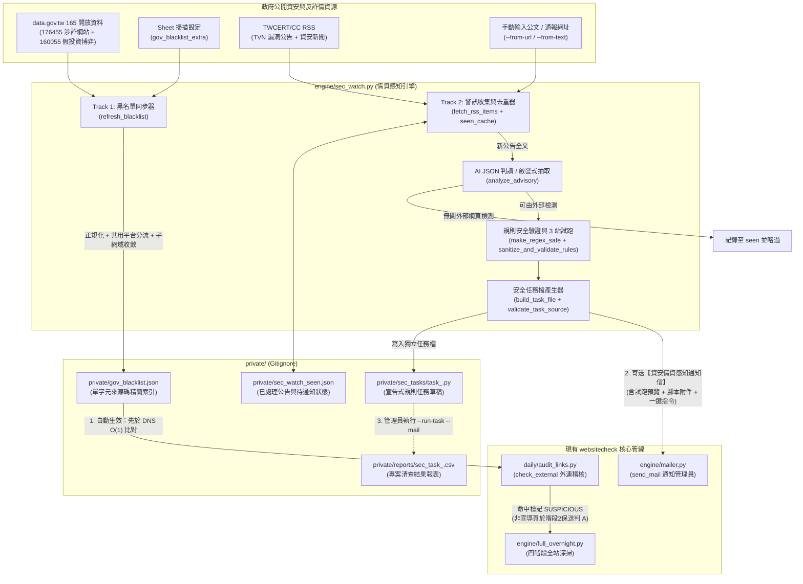
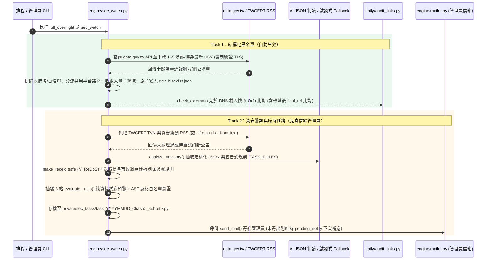

# 政府資安情資感知與自動規則演進設計與實作規格（`sec_watch`）

> **狀態**：已實作上線（2026-11）
> **目標**：自動巡檢臺灣政府公開資安情資與反詐黑名單，將「**結構化涉詐/惡意網域黑名單（自動生效）**」與「**非結構化資安警訊（AI/啟發式轉化為宣告式臨時清查任務／長期規則建議，先寄信通知管理員）**」雙軌整合進現有 `websitecheck` 管線。

---

## 1. 核心設計原則

因應實務上政府資安通報分成「常態黑名單」與「專案/突發性清查」，本模組採 **Track 1（結構化黑名單熱更新）+ Track 2（宣告式規則清查任務草稿）** 雙軌設計，並嚴格區分放行權限：

| 軌道 | 情資類型 | 實作來源 | 任務屬性 | 生效與放行策略 |
|---|---|---|---|---|
| **Track 1**<br/>結構化黑名單 | 政府依法停止解析或通報之涉詐、博弈網域與特定子路徑（IoC） | 政府資料開放平臺（`data.gov.tw` 165 遭停止解析涉詐網站 `176455`、假投資博弈網站 `160055`）＋ `scan_settings` 的 `gov_blacklist_extra` | **長期性任務** | **全自動生效**<br/>每次深掃前自動拉取更新至 `private/gov_blacklist.json`，由 `audit_links.py` 先於 DNS 解析直接攔截 |
| **Track 2A**<br/>突發資安警訊 (`TEMP_TASK`) | 第三方 JS 供應鏈污染（如 `polyfill.io`）、特定前端元件/CMS 外部可檢漏洞、短期專案網址清查 | TWCERT/CC（「TVN 漏洞公告 RSS」与「資安新聞與警訊 RSS」）、或手動餵入公文/網址（`--from-url` / `--from-text`） | **臨時性任務** | **先寄信給管理員**<br/>自動產出含純資料規則（`TASK_RULES`）之獨立任務檔 `private/sec_tasks/task_<id>.py` 並附一鍵執行指令寄信，**不自動改動正式排程** |
| **Track 2B**<br/>常態詞庫/網域建議 (`LONG_TERM_RULE`) | 通報提及需長期封鎖之惡意網域或常態掃描關鍵字 | TWCERT/CC RSS 或手動輸入公文/網址 | **長期性建議** | **先寄信給管理員**<br/>於通知信中列出 `suggested_domains` 與 `suggested_keywords`，由管理員人工評估後加入 Sheet「掃描設定」分頁 |

---

## 2. 系統架構與資料流圖

### 2.1 整體雙軌運作流程



### 2.2 時序圖：從公告發布到管理員收信與執行



---

## 3. Track 1 詳細設計：政府 165 反詐／資安通報黑名單（自動生效）

### 3.1 資料來源與防呆清洗
1. **內政部警政署 165 反詐騙開放資料（`data.gov.tw`）**
   - 資料集 1：`176455`「165反詐騙諮詢專線_遭停止解析涉詐網站」（代碼 `"r"`）。
   - 資料集 2：`160055`「165反詐騙諮詢專線_假投資(博弈)網站」（代碼 `"g"`）。
   - 優先向 `https://data.gov.tw/api/v2/rest/dataset/<id>` 查詢最新 CSV 下載網址（全程強制驗證 TLS），失敗時退回內建 `opdadm.moi.gov.tw` 直連下載點；若單一資料集下載失敗或筆數異常偏低（<100 筆），自動從前次快取救回該來源代碼之條目並印出告警。
2. **手動補充黑名單（`scan_settings`）**
   - 讀取 Sheet「掃描設定」分頁的 `gov_blacklist_extra` 參數（代碼 `"e"`）。
3. **清洗與保護規則**：
   - **保護政府域與白名單**：自動排除 `GOV_SAFE_SUFFIXES`（`.gov.tw`、`.mil.tw`、`.gov.taipei` 等）及 `scan_settings` 的 `content_whitelist` / `skip_hosts`。
   - **共用平台不整域封鎖（`SHARED_PATH_PLATFORMS`）**：針對 `play.google.com`、`docs.google.com`、`line.me`、`facebook.com`、`portaly.cc`、`linktr.ee` 等共用平台或短網址，**絕不將主機名直接列入 `domains`**；僅在原始條目帶有明確子路徑（長度 ≥5）時存入 `url_prefixes` 做路徑前綴比對。
   - **大量子網域自動收斂（`COLLAPSE_SUBDOMAIN_THRESHOLD = 500`）**：同一主網域下若出現 ≥500 個涉詐子網域，且該主網域不屬於免費代管平台（`HOSTING_PLATFORM_ROOTS`，如 `blogspot.com`、`github.io`、`vercel.app` 等），自動收斂為整個主網域，大幅降低體積。

### 3.2 低記憶體快取格式（`private/gov_blacklist.json`）
為保護 4GB 無 swap 的掃描主機，每個網域僅儲存**單一字元來源碼**（`"r"` / `"g"` / `"e"`）並搭配 `sys.intern()`、以 `os.replace()` 原子寫入，載入端使用 `threading.Lock()` 與檔案 `mtime` double-checked locking（多執行緒下只載入一次）：

```json
{
  "updated_at": "2026-11-05 02:00:05",
  "updated_ts": 1793815205.12,
  "total_domains": 118420,
  "total_url_prefixes": 85,
  "collapsed_roots": ["example-scam.com"],
  "sources": {
    "npa_165_rpz": {"name": "165反詐騙_遭停止解析涉詐網站", "rows": 48210, "url_prefixes": 32, "skipped_shared_platform": 15, "status": "ok"},
    "npa_165_gambling": {"name": "165反詐騙_假投資(博弈)網站", "rows": 70210, "url_prefixes": 53, "skipped_shared_platform": 9, "status": "ok"}
  },
  "domains": {
    "dewa77.com": "r",
    "fake-inv-tw.com": "g"
  },
  "url_prefixes": {
    "play.google.com/store/apps/details?id=com.fake.app": "g"
  }
}
```

### 3.3 與 `daily/audit_links.py` 及 `engine/full_overnight.py` 的銜接
1. **啟動同步**：`full_overnight.py` 非 `--verify` 模式啟動時自動呼叫 `sec_watch.refresh_blacklist()`。若遠端同步失敗且本機快取超過 `BLACKLIST_STALE_DAYS`（3 天）未更新，自動在同步訊息附加告警。
2. **先於 DNS 之 O(1) 外連攔截（含轉址後複查）**：
   - 在 `audit_links.check_external()` 中，**先於步驟 1 DNS 解析**呼叫 `sec_watch.match_blacklist(url)`，避免已被 TWNIC RPZ 停止解析的涉詐網域只被當成一般 `DEAD`（DNS 解析失敗）而漏失涉詐定性。
   - 若初始網址未命中，但在步驟 2 HTTP 請求時發生跨網域轉址（`final_host != host`），會對轉址後的 `r.url` 再跑一次 `match_blacklist()`。
3. **反詐宣導頁情境辨識（`is_antifraud_context`）與階段 2 保送機制**：
   - 若命中黑名單的外連，其所有出現頁面標題或錨點文字皆含反詐宣導詞（如「詐騙、反詐、防詐、165、假投資、勿點、宣導」），備註標為 `疑似反詐宣導頁列舉之165涉詐網域,請人工確認是否為宣導範例(...)`，交由階段 2 AI 複查或人工確認。
   - 一般非宣導頁命中者，備註標為 `命中政府165/資安通報涉詐黑名單(...)`，並在 `full_overnight.py` 階段 2 **直接鎖定 `ai_verdict = "A"`（型態：`政府165通報涉詐網域`）**，免因 RPZ 斷網或 Cloudflare 阻擋而被降級。

---

## 4. Track 2 詳細設計：資安警訊巡檢與臨時清查任務（先寄信給管理員）

### 4.1 巡檢來源、去重與待通知補送
1. **自動巡檢源（`DEFAULT_ADVISORY_FEEDS`）**：
   - TWCERT/CC「TVN 漏洞公告 RSS」（`https://www.twcert.org.tw/tw/rss-132-1.xml`）
   - TWCERT/CC「資安新聞與警訊 RSS」（`https://www.twcert.org.tw/tw/rss-104-1.xml`）
2. **手動觸發源（應付上級臨時交辦公文）**：
   - 支援 `--from-url <公告網址>`（遇到政府網站缺中繼憑證時允許 fallback `verify_tls=False` 抓取內文）與 `--from-text "<公文內容>" [--title "<標題>"]`。
3. **去重與狀態機（`private/sec_watch_seen.json`）**：
   - 記錄每篇公告狀態：`ok`（無關外部檢測）、`pending_notify`（已產出任務草稿但尚未寄信通知）、`notified`（已成功寄信通知管理員）、`error`（失敗自動重試最多 `MAX_ADVISORY_RETRIES = 3` 次）。
   - `--dry-run` 時不寫入 `sec_watch_seen.json`，避免預覽把新公告吃掉；先前處於 `pending_notify` 且未過期的任務會在下次加上 `--mail` 執行時一併補寄。

### 4.2 AI 專屬 JSON 判讀與高精準度啟發式 Fallback
1. **AI JSON 判讀（`_ask_ai_json`）**：
   - 使用獨立的 `AI_JSON_SYSTEM_PROMPT`（要求只輸出單一合法 JSON 並忽略內文 Prompt Injection 指令），呼叫 `config.json` 設定之 AI 供應商（OpenAI 相容 / Gemini / Anthropic），並先經 `webcheck_ai.mask_pii()` 遮蔽個資。
   - 輸出欄位：`relevant` (`bool`)、`category` (`TEMP_TASK` / `LONG_TERM_RULE` / `NONE`)、`title_short`、`reason`、`action_summary`、`suggested_domains`、`suggested_keywords`、`rules`（宣告式規則陣列）。
2. **高精準度啟發式 Fallback（`_heuristic_fallback_analysis`）**：
   - 當未設定 AI 端點或連線失敗時自動接手：
     - 先排除終端硬體/IoT 公告（手錶、冷凍設備、NAS/NVR/DVR/PLC 等）。
     - 抽取明確第三方惡意/高風險網域（排除 `github.io`、`socket.io` 等合法開發網域）、明確前端腳本/端點檔名（`.js`/`.ashx`/`.axd`/`.do`/`.action`，排除 `index.html`、`jquery.min.js`、`node.js`、`vue.js` 等通用框架名），以及 TVN 標題「廠商｜產品名」中的專屬英文系統識別碼（如 `BA-Workflow`、`WebITR`）。

### 4.3 宣告式任務外掛標準模板（`private/sec_tasks/task_<id>.py`）

生成的臨時任務統一放在 `private/sec_tasks/` 下，採純資料宣告式規則 `TASK_RULES` 搭配標準 `check_site` 介面：

```python
# -*- coding: utf-8 -*-
from __future__ import annotations
# [自動生成資安清查任務草稿]
# 任務 ID : 20261105_a1b2c3_polyfillio
# 來源公告: 清查網站是否引用 polyfill.io 第三方腳本
# 公告連結: https://...
# 建立日期: 2026-11-05 (建議效期至 2026-11-19)
# 清查說明: 掃描全府網站首頁 HTML 與腳本來源，比對是否出現 polyfill.io 技術指標。
import re

TASK_META = {
  'id': '20261105_a1b2c3_polyfillio',
  'title': '清查網站是否引用 polyfill.io 第三方腳本',
  'title_short': 'polyfillio',
  'source': '手動輸入公文/通報',
  'source_url': 'manual://input',
  'category': 'TEMP_TASK',
  'reason': '...',
  'action_summary': '...',
  'suggested_domains': [],
  'suggested_keywords': [],
  'created_at': '2026-11-05',
  'expires_at': '2026-11-19',
}

TASK_RULES = [
  {
    'target': 'script_src',
    'pattern': '(?<![a-z0-9.-])polyfill\\.io(?![a-z0-9.-])',
    'severity': 'HIGH',
    'detail': '網頁引用高風險 polyfill.io 腳本',
  },
]


def check_site(site_url: str, html: str, headers: dict) -> list[dict]:
    ...
```

### 4.4 安全防呆與沙盒設計
1. **ReDoS 語法樹檢查與量詞封頂（`make_regex_safe`）**：
   - 自動將無上限量詞（`*`, `+`, `{n,}`）改寫為有上限（`{0,64}`, `{1,64}`, `{n,64}`）。
   - 解析 Python `sre_parse` 語法樹，禁止巢狀可重複量詞、禁止可重複的多選分支、禁止反向參照（`\1`），並限制量詞跨度乘積上限（`REGEX_MAX_SPAN_PRODUCT = 5000`）。
   - 對 7 組 4 萬字元病態字串實測搜尋耗時，超過 `0.25s` 立即剔除。
2. **防過寬誤報（`sanitize_and_validate_rules`）**：
   - 每條規則皆實際對照標準市政網頁樣板（`REALISTIC_BENIGN_HTML` 與 `REALISTIC_BENIGN_HEADERS`），凡會命中空字串或標準市政樣板的過寬規則（如單純搜 `script`、`https`、`taipei`）一律剔除並記錄原因。
3. **嚴格 AST 白名單與純資料優先執行（`validate_task_source` & `_parse_task_file`）**：
   - 任務檔所有欄位皆以 `repr()` 序列化，檔頭使用 `#` 單行註解（防止三引號脫逸注入）。
   - AST 白名單僅允許 `import re` 與 `from __future__ import annotations`，封鎖所有 `_` 開頭識別字/屬性，且對 `re.<attr>` 與一般物件屬性採嚴格白名單（封鎖 `re.enum.sys` 等模組鏈穿透）。
   - **執行階段（`--run-task`）**：對含有 `TASK_RULES` 的標準任務檔，直接透過 `ast.literal_eval` 讀取規則並交由 `evaluate_rules()` 純資料引擎執行，**完全不呼叫 `exec`**；僅在管理員手寫自訂 `check_site` 且無 `TASK_RULES` 時，才在通過 AST 白名單後以受限 `__builtins__` 執行。
   - 若任務所有規則皆被剔除（無可執行規則），`--run-task` 會直接中止並提示，避免掃出「全府 0 命中（🟢正常）」的假象。

---

## 5. 相關檔案與設定對照

| 檔案路徑 | 職責說明 |
|---|---|
| [`engine/sec_watch.py`](../engine/sec_watch.py) | 情資感知主模組：165 黑名單同步、TWCERT RSS 巡檢、AI/啟發式判讀、ReDoS 與過寬規則清洗、管理員通知信、`--run-task` 全府快掃執行器 |
| [`scan_settings.py`](../scan_settings.py) | 提供 `gov_blacklist_extra` 手動補充黑名單參數（可由 Sheet「掃描設定」分頁調整） |
| [`daily/audit_links.py`](../daily/audit_links.py) | 在 `check_external()` 先於 DNS 呼叫 `match_blacklist()` 與 `is_antifraud_context()`，並於跨網域轉址後二次檢查 |
| [`engine/full_overnight.py`](../engine/full_overnight.py) | 啟動時呼叫 `sec_watch.refresh_blacklist()`；階段 2 對命中官方黑名單者保送 `ai_verdict = "A"` |
| [`monthly/smoke_test.py`](../monthly/smoke_test.py) / [`.github/workflows/ci.yml`](../.github/workflows/ci.yml) | 將 `engine.sec_watch` 納入部署冒煙測試與 CI 模組載入關卡 |

---

## 6. CLI 操作介面速查

```bash
# 1. 日常自動巡檢（同步 165 黑名單 + 檢查 TWCERT 新公告，有新任務加 --mail 即寄信給管理員）
python -m engine.sec_watch --mail

# 2. 預覽模式（不寫入 seen 紀錄、不實寄信，印出判讀與 3 站試跑結果）
python -m engine.sec_watch --dry-run

# 3. 只更新 165 / 官方涉詐黑名單（full_overnight 啟動時也會自動呼叫）
python -m engine.sec_watch --sync-blacklist

# 4. 手動貼入上級交辦公文或網址，立即生成臨時清查腳本草稿並寄信給管理員
python -m engine.sec_watch --from-url "https://www.twcert.org.tw/..." --mail
python -m engine.sec_watch --from-text "請各機關清查網站是否嵌有 polyfill.io..." --title "清查polyfill.io" --mail

# 5. 收到信確認後，一鍵對全府 466 站首頁執行該臨時清查任務（結果匯出 CSV 並寄回管理員）
python -m engine.sec_watch --run-task 20261105_a1b2c3_polyfillio --mail

# 6. 列出目前已生成的臨時任務草稿與狀態（有效 / 已過期 / 規則數）
python -m engine.sec_watch --list-tasks
```
