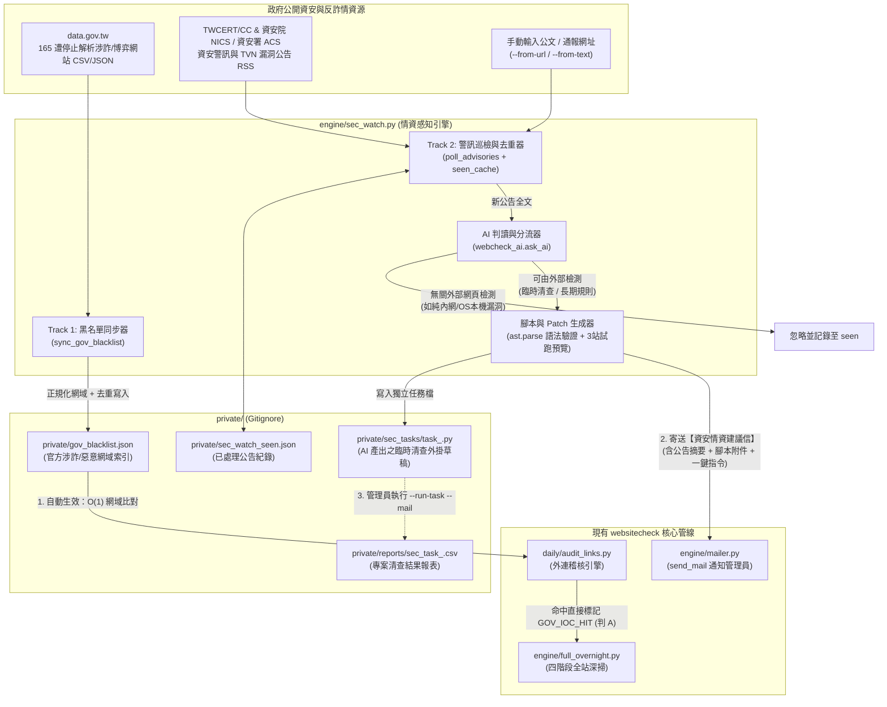
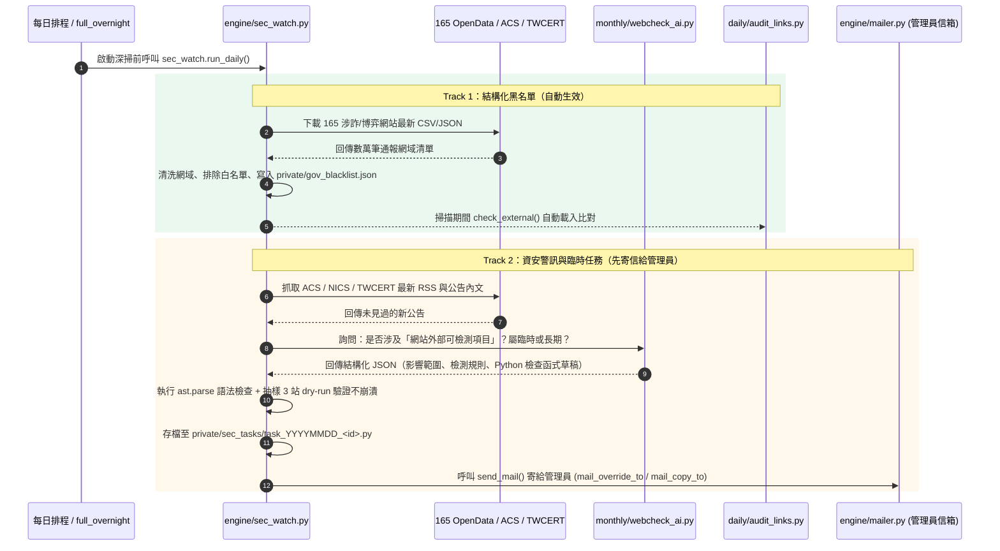

# 政府資安情資感知與自動規則演進設計規格（`sec_watch`）

> **狀態**：設計規格（Phase 3 規劃）
> **目標**：自動巡檢臺灣政府公開資安情資與反詐黑名單，將「**結構化涉詐/惡意網域黑名單（自動生效）**」與「**非結構化資安警訊（AI 轉化為臨時清查任務／長期規則建議，先寄信通知管理員）**」雙軌整合進現有 `websitecheck` 管線。

---

## 1. 核心設計原則

因應實務上政府資安通報分成「常態黑名單」與「專案/突發性清查」，本模組採 **A（資料/黑名單熱更新）+ B（AI 生成檢核腳本/規則）混搭**，並嚴格區分放行權限：

| 軌道 | 情資類型 | 代表來源 | 任務屬性 | 生效與放行策略 |
|---|---|---|---|---|
| **Track 1**<br/>結構化黑名單 | 政府依法停止解析或通報之涉詐、博弈、釣魚、惡意中繼網域（IoC） | 政府資料開放平臺（`data.gov.tw` 165 涉詐/博弈網站清單）、TWCERT/CC 惡意網域 | **長期性任務**<br/>（的做法 A） | **全自動生效**<br/>每次深掃前自動拉取更新至 `private/gov_blacklist.json`，由 `audit_links.py` 直接攔截 |
| **Track 2A**<br/>突發資安警訊 | 第三方 JS 供應鏈污染（如 `polyfill.io`）、特定前端元件漏洞、短期專案網址清查 | 數發部資安署（ACS）、資安院（NICS）、TWCERT/CC RSS、或手動餵入公文 | **臨時性任務**<br/>（的做法 B） | **先寄信給管理員**<br/>AI 自動寫出獨立清查腳本草稿（`private/sec_tasks/`）並附執行指令寄信，**不自動改動正式排程** |
| **Track 2B**<br/>常態規範演進 | 新型態掛馬/跳板手法、HTTP 資安標頭或網站規範修正 | 數發部（MODA）、資安署常態規範公告 | **長期性任務**<br/>（的做法 A/B） | **先寄信給管理員**<br/>AI 產出 `scan_settings` 詞庫擴充建議或核心 `.py` Patch Diff 寄信，人工確認後才併入版控 |

---

## 2. 系統架構與資料流圖

### 2.1 整體雙軌運作流程



### 2.2 時序圖：從公告發布到管理員收信與執行



---

## 3. Track 1 詳細設計：政府反詐／惡意網域黑名單（自動生效）

### 3.1 資料來源
1. **內政部警政署 165 反詐騙開放資料（`data.gov.tw`）**
   - 資料集：**「165反詐騙諮詢專線_遭停止解析涉詐網站」** 及 **「165反詐騙諮詢專線_假投資(博弈)網站」**。
   - 特性：官方定期更新之 CSV / JSON，欄位包含網站名稱、網址/網域（Domain）、通報日期。
2. **TWCERT/CC 公開情資與自訂補充黑名單**
   - 支援從 TWCERT 公告中由正規表示式自動抽取的惡意 Domain / IP（IoC），並可由 `scan_settings` 的 `gov_blacklist_extra` 參數手動追加。

### 3.2 快取格式（`private/gov_blacklist.json`）
與 [`scan_settings.py`](../scan_settings.py) 採用相同的「**主行程更新一次、子行程唯讀快取**」模式，避免 466 個 worker 重複載入或打 API：

```json
{
  "updated_at": "2026-11-04 02:00:05",
  "sources": {
    "npa_165_rpz": {"count": 48210, "status": "ok"},
    "twcert_ioc": {"count": 312, "status": "ok"}
  },
  "domains": {
    "dewa77.com": {"src": "165", "date": "2026-10"},
    "fake-inv-tw.com": {"src": "165", "date": "2026-11"}
  }
}
```

### 3.3 與 `daily/audit_links.py` 及 `engine/full_overnight.py` 的銜接
1. **啟動更新**：[`engine/full_overnight.py`](../engine/full_overnight.py) 啟動時（與 `scan_settings.refresh()` 同處），呼叫 `sec_watch.refresh_blacklist()`。若政府開放平臺連線超時，自動沿用既有 `private/gov_blacklist.json` 快取，絕不中斷深掃。
2. **O(1) 外連攔截**：在 [`daily/audit_links.py`](../daily/audit_links.py) 的 `check_external(url)` 中：
   - 將外連 `host` 轉小寫並去 `www.`，同時檢查註冊主網域（例如 `sub.evil.com` 檢查 `sub.evil.com` 與 `evil.com`）。
   - 若命中 `gov_blacklist.json`（且不在 `GOV_EXCLUSIVE_SUFFIXES` 與 `content_whitelist` 內）：
     - 直接回傳 `("SUSPICIOUS", "命中政府165/資安通報涉詐黑名單(來源:165)")`。
3. **階段 2 AI 複查保送機制**：
   - 在 [`engine/full_overnight.py`](../engine/full_overnight.py) 階段 2 `ai_verify` 中，凡 detail 帶有 `命中政府165/資安通報涉詐黑名單` 者，**直接鎖定 `ai_verdict = "A"`（真搶註/涉詐）**，不因對方網站當下開啟 Cloudflare 阻擋或偽裝成空白頁而被 AI 誤降級為 `C`。

---

## 4. Track 2 詳細設計：資安警訊巡檢與臨時任務生成（先寄信給管理員）

### 4.1 巡檢來源與去重
1. **自動巡檢源**：
   - 國家資通安全研究院（NICS）/ 數發部資安署（ACS）漏洞與資安警訊公告。
   - TWCERT/CC「TVN 漏洞公告 RSS」與「資安新聞 RSS」。
2. **手動觸發源（應付上級臨時交辦公文）**：
   - 支援指令：`python -m engine.sec_watch --from-text "請各機關清查網站是否使用..."` 或 `--from-url <公告網址>`。
   - 當收到上級公文或 Line 轉傳的資安通報時，直接貼給它即可自動生出清查腳本並寄信。
3. **去重機制**：
   - 以公告 URL 或內容 SHA-256 雜湊記錄於 `private/sec_watch_seen.json`，已分析過的公告不重複呼叫 AI、不重複寄信。

### 4.2 AI 兩階段判讀 Prompt 規格（透過 `monthly/webcheck_ai.py`）

對每篇新公告，呼叫 `webcheck_ai.ask_ai()` 輸出結構化 JSON：

1. **第一問：這篇公告跟「政府網站外部檢測」有沒有關係？**
   - `relevant: false`：例如 Windows 內部機房漏洞、VPN 設備韌體更新、公務員社交工程演練等無法從公開網頁 HTML / HTTP Header / 外連看出來的公告 → 直接略過。
   - `relevant: true`：例如
     - 網站嵌入特定惡意/高風險第三方腳本或網域（如 `polyfill.io`、特定 CDN）
     - 網站外連出現新型態短網址跳板或特定詐騙 TLD
     - 特定 Web 框架／CMS 前台特徵或暴露特定路徑（如 `/wp-json/...`、特定 `.ashx` 端點）
     - 新增 HTTPS / Security Headers / 政府網站標示合規要求
2. **第二問：分類為「臨時性任務（`TEMP_TASK`）」或「長期性規則（`LONG_TERM_RULE`）」？**
   - **`TEMP_TASK`（臨時性專案清查）**：針對單一事件、特定 CVE、特定第三方元件清查。AI 自動產出符合標準介面的獨立 Python 檢查腳本草稿。
   - **`LONG_TERM_RULE`（長期性規則建議）**：
     - 若只需加關鍵字／黑名單網域 → 產出建議新增至 `scan_settings` 的詞彙與網域清單。
     - 若需改動 [`daily/audit_links.py`](../daily/audit_links.py) 或 [`engine/compliance.py`](../engine/compliance.py) 常態邏輯 → 產出建議修改區段與 Unified Diff。

### 4.3 臨時任務外掛標準介面（`private/sec_tasks/task_<id>.py`）

為了**絕對不污染現有核心程式碼**，AI 生成的臨時任務統一放在 `private/sec_tasks/` 下，並遵循以下固定模板：

```python
# -*- coding: utf-8 -*-
"""[自動生成臨時任務草稿]
來源公告: 數發部資安署 - 清查網站是否引用 polyfill.io 第三方腳本
公告連結: https://...
生成時間: 2026-11-04 16:30:00
建議效期: 2026-11-18 (14天)
"""
import re

TASK_META = {
    "id": "20261104_polyfill_io",
    "title": "清查全府網站是否引用 polyfill.io 惡意供應鏈腳本",
    "source_url": "https://...",
    "created_at": "2026-11-04",
    "expires_at": "2026-11-18",
    "scope": "all_466",          # all_466 (全466站首頁) 或 compliance_only
    "need_extra_requests": False # False=只檢查首頁 HTML/Headers，30秒內可掃完全府466站
}

def check_site(site_url: str, html: str, headers: dict) -> list[dict]:
    """對單一網站進行臨時清查。
    回傳命中問題 list，無問題回傳 []。
    每筆問題格式: {"severity": "HIGH"|"WARN", "detail": "命中原因說明", "evidence": "片段"}
    """
    hits = []
    for m in re.finditer(r"https?://[^\"'\s>]*polyfill\.io[^\"'\s>]*", html or "", re.I):
        hits.append({
            "severity": "HIGH",
            "detail": "網頁原始碼引用高風險 polyfill.io 腳本",
            "evidence": m.group(0)[:120]
        })
    return hits
```

### 4.4 自動安全防呆（零未審核程式碼執行 + 嚴格 AST 白名單）
為杜絕惡意網頁／Prompt Injection 誘導 AI 產出危險程式碼：
1. **巡檢與試跑階段「零 `exec`」**：AI 只輸出純資料結構之宣告式規則（`TASK_RULES`），3 站預覽試跑由 `sec_watch.evaluate_rules()` 純正規表示式引擎執行，**在管理員人工審閱前絕不動態載入或執行任何生成的 `.py` 檔**。
2. **安全序列化與防誤報檢查**：所有寫入 `task_<id>.py` 的字串一律經 `repr()` 跳脫並使用 `#` 單行註解（杜絕三引號脫逸注入）；每條 regex 皆驗證不可命中空字串或正常市政網頁樣板。
3. **執行階段嚴格 AST 白名單與效期控管**：管理員執行 `--run-task` 時，強制檢查 `expires_at`（過期自動停用，除非加 `--force`），並以 AST 白名單攔截除 `re` 以外的所有 `import`、所有底線 `_` 屬性存取（如 `__builtins__`）與 `getattr`/`open`/`eval` 等內建呼叫。

### 4.5 寄信通知管理員（複用 `engine/mailer.py`）
- **收件人**：讀取 `config.get("mail_override_to")` 或 `config.get("mail_copy_to")`（管理員信箱，絕不直接寄給各局處承辦人）。
- **信件主旨**：`[資安情資感知] 發現可執行之新通報：<公告標題>（含臨時清查腳本草稿）`
- **信件內容（HTML）**：
  1. **公告摘要與來源連結**
  2. **AI 判讀分類**：臨時性清查任務 vs 長期性規則建議
  3. **抽樣 3 站試跑結果**：耗時、是否觸發命中
  4. **一鍵執行指令**：
     - 若你看完信覺得需要立刻清查全府 466 站，只要在主機執行信中附的一行指令：
       ```bash
       python -m engine.sec_watch --run-task 20261104_polyfill_io
       ```
     - 該指令會用多執行緒在 1~2 分鐘內掃完全府 466 站首頁，產出 `private/reports/sec_task_20261104_polyfill_io.csv` 並將完整清查結果寄回給你。
- **附件**：生成的 `task_<id>.py`（或 `.diff` 建議檔）。

---

## 5. 新增與修改檔案清單（實作範圍預覽）

實作時對既有程式碼的改動極小，保持高內聚、低耦合：

| 檔案路徑 | 動作 | 說明 |
|---|---|---|
| `engine/sec_watch.py` | **新增** | 情資感知主模組：165 黑名單同步、ACS/TWCERT RSS 巡檢、AI 判讀生成臨時任務、寄送管理員通知信、`--run-task` 執行器 |
| `daily/audit_links.py` | **微調 (~15 行)** | 載入 `private/gov_blacklist.json`，在 `check_external()` 加入官方黑名單 O(1) 比對 |
| `engine/full_overnight.py` | **微調 (~10 行)** | 啟動時呼叫 `sec_watch.refresh_blacklist()`；階段 2 對命中官方黑名單者保送 `ai_verdict = "A"` |
| `config.example.json` | **微調 (~6 行)** | 新增可選的 `sec_watch` 設定區段（開放資料 URL、RSS 清單、通知信箱 fallback） |
| `monthly/smoke_test.py` | **微調 (~2 行)** | 將 `engine.sec_watch` 納入模組匯入冒煙測試 |

---

## 6. CLI 操作介面設計

```bash
# 1. 日常自動巡檢（同步 165 黑名單 + 檢查新資安公告，有新任務就寄信給管理員）
python -m engine.sec_watch

# 2. 只更新 165 / 官方涉詐黑名單（full_overnight 啟動時也會自動呼叫）
python -m engine.sec_watch --sync-blacklist

# 3. 手動貼入上級交辦公文或網址，讓 AI 立刻生成臨時清查腳本並寄信給你
python -m engine.sec_watch --from-url "https://www.acs.gov.tw/..."
python -m engine.sec_watch --from-text "請各機關清查網站是否嵌有 xxx.js..."

# 4. 收到信後，一鍵對全府 466 站執行該臨時清查任務（結果匯出 CSV 並寄給管理員）
python -m engine.sec_watch --run-task 20261104_polyfill_io --mail

# 5. 列出目前已生成的臨時任務與狀態（有效 / 已過期）
python -m engine.sec_watch --list-tasks
```
